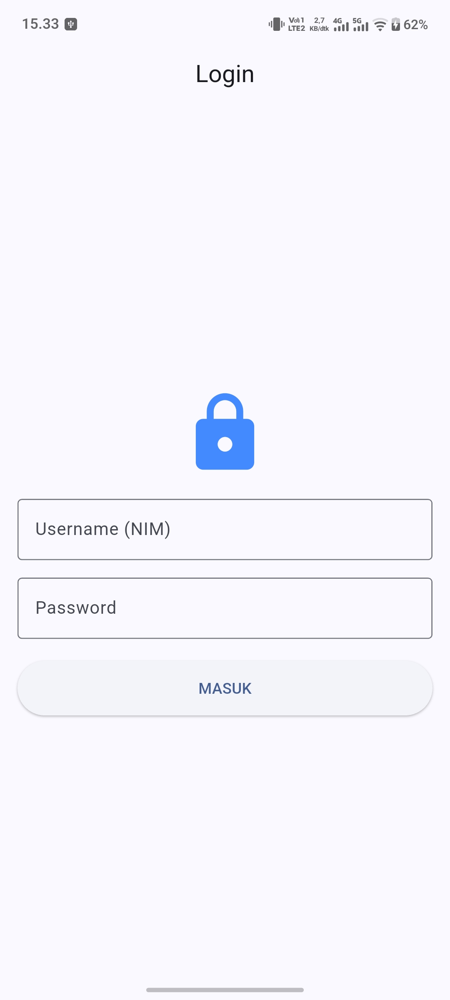
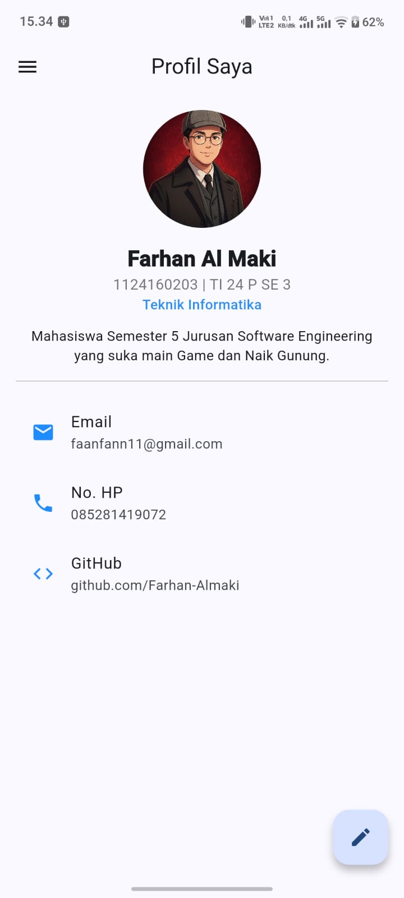
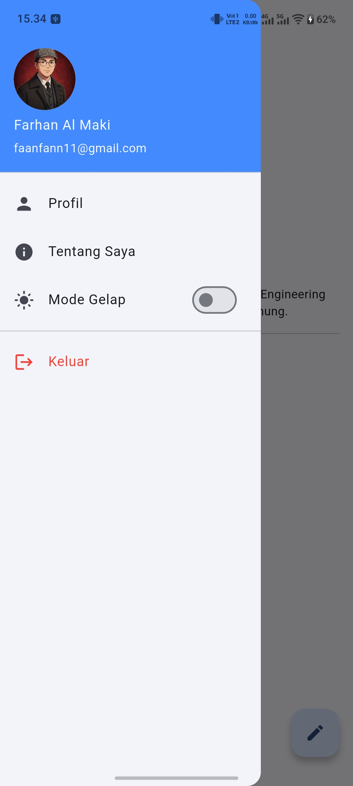
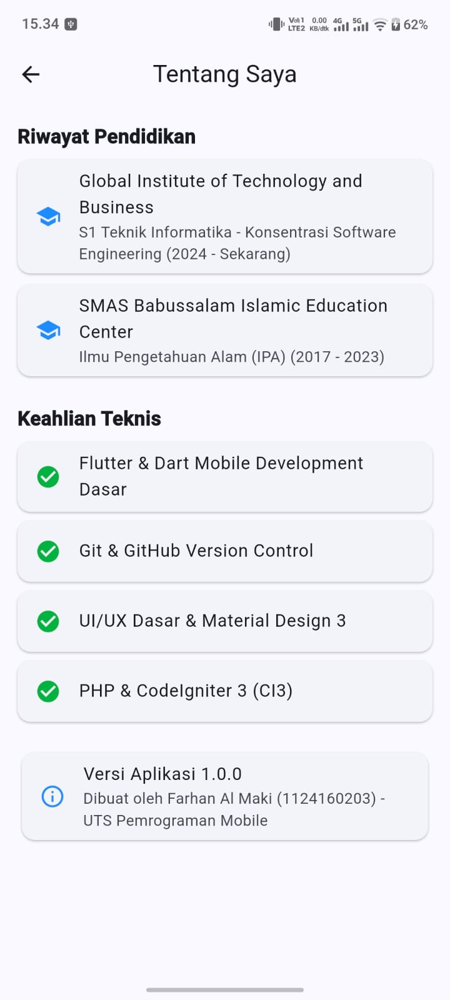
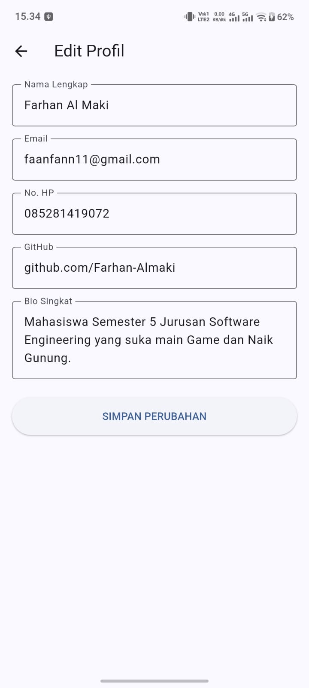

# UTS Pemrograman Mobile Lanjutan - Aplikasi Profil Mahasiswa

## Identitas Mahasiswa
- **Nama:** Farhan Al Maki
- **NIM:** 1124160203
- **Kelas:** TI 24 P SE 3
- **Program Studi:** Teknik Informatika (Konsentrasi : Software Engineering)
- **Institusi:** Global Institute of Technology and Business

## Link YouTube
- **Link YouTube:** [Tonton Video Demo Aplikasi Profil Farhan](https://youtu.be/sQvYM5QKIwM)

## Screenshot Aplikasi

| Halaman Login | Halaman Profil | Menu Drawer | Halaman Tentang Saya | Halaman Edit Profil |
| :---: | :---: | :---: | :---: | :---: |
| |  |  |  |  |

## Daftar Fitur
- **Login (`LoginPage`):** Validasi input NIM dan password menggunakan `GlobalKey<FormState>` sebelum masuk ke halaman utama menggunakan `Navigator.pushReplacement`.
- **Profil Mahasiswa (`ProfilePage`):** Menampilkan foto dari aset lokal (`assets/images/foto_profil.jpg`) dengan `CircleAvatar`, biodata lengkap, kartu kontak menggunakan *reusable widget* `InfoTile`, navigasi `Drawer`, serta pengubah tema **Light / Dark Mode**.
- **Edit Profil (`EditProfilePage`):** Formulir pembaruan data menggunakan `TextEditingController` dan validasi `GlobalKey<FormState>`, lalu mengirimkan data terbaru kembali ke halaman profil via `Navigator.pop`.
- **Tentang Saya (`AboutPage`):** Menampilkan riwayat pendidikan dan keahlian teknis menggunakan `ListView`.

## Cara Menjalankan Aplikasi
1. Clone repository ini ke komputer lokal: git clone https://github.com/Farhan-Almaki/uts_pml_1124160203.git
2. Masuk ke direktori proyek : cd uts_pml_1124160203/soal_2_profil_app
3. Unduh seluruh paket dependensi: flutter pub get
4. Jalankan aplikasi pada emulator: flutter run